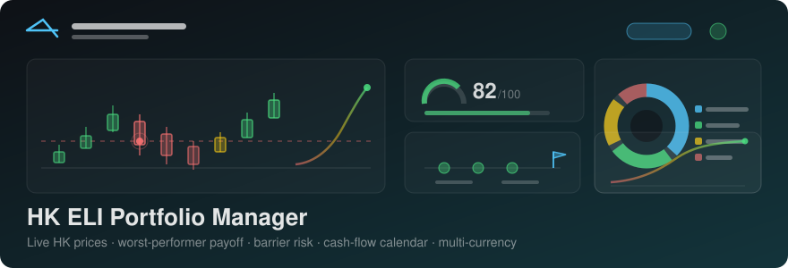

<p align="center">
  
</p>

<p align="center">
  <strong>Live HK prices</strong> · worst-performer payoff · barrier risk · cash-flow calendar · multi-currency
</p>

---

# HK ELI Portfolio Manager — GitHub Pages Edition

An interactive web app for managing Hong Kong Equity-Linked Investment (ELI)
deals with live price updates from **Yahoo Finance** (called directly from your
browser). Create and edit ELI deals (single or basket up to 4 HK stocks),
visualize allocations and performance with charts, and track barrier risks
and alerts.

**100% static. No server. No Docker. Free GitHub Pages hosting.**

This project was originally a Flask + MySQL app deployed via Docker. It has
been redesigned so the entire app runs in the browser — deal data lives in
`localStorage`, prices are fetched directly from Yahoo Finance's public
endpoint, and an optional Finnhub key can be set as a fallback.

---

## ✨ Features

- Add, edit, delete HK ELI deals (1–4 underlying HK stocks per deal)
- **Live HK stock prices** — fetched directly from Yahoo Finance in the
  browser, with a 3-minute in-memory + `localStorage` cache
- **Finnhub fallback** — paste your own free Finnhub API key in Settings;
  used automatically when Yahoo is rate-limited or unreachable
- **Auto status calculation** — barrier breach, approaching maturity, settled
- **Risk analytics** — HK market concentration, barrier risk exposure,
  diversification score
- **Charts** — allocation doughnut, performance bars, stock-count distribution
  (Chart.js)
- **Alerts** — barrier proximity / breach, approaching maturity, bell-badge
  popover
- **Import / Export** — CSV (single click) and JSON (full backup including
  settings) for moving data between devices
- **HKEX market-hours indicator** (Mon–Fri 9:30–12:00 and 13:00–16:00 HKT)
- Mobile-friendly responsive UI

### Payoff + history

- **Payoff Projector** — for any deal, project the cash-equivalent payoff at
  maturity using worst-performer logic (par redemption if no knock-in,
  worst-performer physical otherwise). Adjust a shock slider (-50%…+20%)
  to see how a uniform move across all underlyings would change the deal.
- **Per-symbol price history** — daily snapshots recorded automatically on
  every successful refresh. Spans up to 90 days (auto-pruned) and powers
  the per-deal drawdown analysis.
- **Scenario Simulator** — stress-test the whole portfolio with a uniform
  shock or a worst-of-only shock and see how each deal would settle.

### Smarter analytics

- **Sector concentration doughnut** — exposure broken down by Hang Seng
  sector (Technology, Financials, Real Estate, Utilities, etc.).
- **Issuer exposure chart** — share of portfolio value by issuing bank.
- **Per-deal max-drawdown list** — the worst peak-to-trough move on the
  weakest underlying of each deal.
- **Payoff sweep curve** — payoff vs uniform shock, with the knock-in
  threshold marked automatically.

### UX polish

- **Dark mode toggle** in the header (cycles auto → light → dark; persisted
  to localStorage).
- **Keyboard shortcuts** — `N` new deal, `R` refresh prices, `1`–`7` switch
  views, `/` focus search, `?` show shortcut help, `Esc` close modal/sidebar.
- **Settings tabs** — the four long cards are now collapsed into a tab
  strip (Data Refresh, Market Prefs, SQLite, Price Source).
- **Accessibility** — aria-labels on icon-only buttons, focus-visible
  outlines, screen-reader announcements for toasts (`role="status"`,
  `aria-live="polite"`).

### Engineering quality

- **JSDoc typedefs** in `js/types.js` for IDE intellisense (`Deal`,
  `UnderlyingAsset`, `Alert`, `PayoffProjection`, etc.).
- **Expanded test suite** — `tests.html` now covers payoff math, sector
  tagging, price-history persistence, max-drawdown, and live Yahoo calls
  (network permitting).
- **CI workflow** — `.github/workflows/ci.yml` runs on every push: JS
  syntax check, JSDoc sanity, required-files presence, JSON validity,
  HTML smoke, README sanity. No external dependencies.
- **PWA support** — installable via `manifest.webmanifest`, offline shell
  via `sw.js`. Financial APIs are NEVER cached (stale prices = bad).

---

## 🆚 What changed vs the old Docker version

| Old (Docker) | New (GitHub Pages) |
| --- | --- |
| Flask API + MySQL/SQLite | Browser-only — no backend |
| `yfinance` Python library | Direct `fetch()` to Yahoo Finance chart endpoint |
| Finnhub via server-side env var | Optional user-supplied key stored in `localStorage` |
| `Dockerfile` + `docker-compose.yml` | `.github/workflows/deploy.yml` (auto-deploy on push) |
| `requirements.txt` | None — just static HTML/CSS/JS |
| `pytest` test suite | Removed (server logic no longer exists) |
| `.env` with DB credentials | Not needed |
| API key for write protection | Not applicable — there is no write endpoint |

**Trade-offs to know about**

- Data is per-browser. To move data between devices, use **Settings →
  Backup All Data** (JSON download) and **Restore from Backup** on the
  other machine. CSV export/import also works for the deals only.
- Yahoo Finance does not publish an official CORS-enabled endpoint. The
  free public chart endpoint (`query1.finance.yahoo.com`) does respond
  with permissive CORS in practice, but Yahoo can throttle. The app
  mitigates this with a 3-minute cache, sequential fetches with small
  delays, and a graceful fallback to Finnhub.

---

## 🚀 Deploy in 60 seconds (GitHub Pages)

1. Push this folder to a new GitHub repository (any name).
2. On GitHub: **Settings → Pages → Build and deployment → Source**:
   choose **GitHub Actions**.
3. That's it. The included `.github/workflows/deploy.yml` deploys on
   every push to `main`. Your site will be live at
   `https://<user>.github.io/<repo>/`.

To deploy from your local checkout:

```bash
cd ELI_DEAL
git init
git add .
git commit -m "Initial commit"
gh repo create ELI_DEAL --public --source=. --push
# Then on GitHub: Settings → Pages → Source = "GitHub Actions"
```

Or push to an existing repo:

```bash
git remote add origin https://github.com/<you>/<repo>.git
git push -u origin main
```

---

## 🧪 Run locally (no install needed)

Just open `index.html` in a browser. That's the whole app.

If your browser blocks `file://` fetch / localStorage quirks, serve the
folder with any static server:

```bash
# Python (no install if you have Python 3)
python3 -m http.server 8000
# Then open http://localhost:8000
```

```bash
# Or Node
npx http-server -p 8000
```

---

## 🗂 Project structure

```
ELI_DEAL/
├── index.html                 # App shell — loads the modules below
├── style.css                  # Design system + application styles
├── app.js                     # Main app: UI, state, rendering, events
├── manifest.webmanifest       # PWA manifest (installable, theme color, shortcuts)
├── sw.js                      # Service worker (offline shell, no price caching)
├── assets/                    # PWA icons (192 + 512)
├── js/
│   ├── types.js               # JSDoc typedefs + ELI_CONSTANTS (IDE hints only)
│   ├── db.js                  # SQLite (sql.js) + OPFS persistence + price cache
│   ├── storage.js             # localStorage wrapper (deals, settings, cache)
│   ├── yahoo-finance.js       # Direct fetch to Yahoo Finance chart endpoint
│   ├── finnhub.js             # Optional fallback when user supplies a key
│   ├── sectors.js             # HK sector tagging for analytics
│   └── payoff.js              # Worst-performer payoff calculator + history helpers
├── .github/workflows/
│   ├── deploy.yml             # Auto-deploy to GitHub Pages on push
│   └── ci.yml                 # JS syntax + JSDoc sanity + required files + JSON
├── .nojekyll                  # Skip Jekyll processing on Pages
├── .gitignore
├── LICENSE                    # MIT
├── README.md
└── tests.html                 # Inline browser test suite (open in browser)
```

---

## ⚙️ Configuration

There is no `.env` file anymore. All configuration lives in **Settings**:

| Setting | Where | Purpose |
| --- | --- | --- |
| Auto-refresh interval | Settings → Data Refresh | How often prices re-fetch (1 h / 4 h / 8 h / 12 h / 24 h) |
| Price alert threshold | Settings → Market Preferences | Trigger "Barrier Proximity" alerts within X% of barrier |
| Finnhub API key | Settings → Price Source | Optional fallback when Yahoo is rate-limiting |

**Finnhub key** — Sign up at <https://finnhub.io> for a free key (60 calls/min
on the free tier). Paste it into Settings → Price Source. The key is stored
only in your browser's `localStorage`; it never leaves your machine except
for direct calls to `finnhub.io`.

---

## 📦 Data model

A deal is a plain JSON object:

```jsonc
{
  "id": "ELI-HK001",
  "dealName": "Tencent + Alibaba Basket",
  "investmentDate": "2025-08-29",
  "maturityDate": "2026-05-01",
  "nominalAmount": 100000,
  "purchasePrice": 98000,
  "numberOfStocks": 2,
  "couponRate": 12.5,
  "settlementMethod": "Worst Performer Physical",
  "issuer": "Credit Suisse",
  "status": "Active",
  "currentValue": 103120,
  "pnl": 5120,
  "underlyingAssets": [
    {
      "symbol": "0700.HK",
      "name": "Tencent Holdings Ltd",
      "strikePrice": 380.00,
      "barrierLevel": 304.00,
      "weight": 0.5,
      "currentPrice": 412.50
    },
    {
      "symbol": "9988.HK",
      "name": "Alibaba Group",
      "strikePrice": 95.00,
      "barrierLevel": 76.00,
      "weight": 0.5,
      "currentPrice": 88.20
    }
  ],
  "createdAt": "2025-08-29T10:00:00.000Z"
}
```

`status` is recalculated on every price refresh:

1. Maturity passed → `Settled`
2. Any underlying ≤ barrier → `Knock-in Triggered`
3. Within 30 days of maturity → `Approaching Maturity`
4. Otherwise → `Active`

---

## 🔐 Security notes

- **No secrets in the repo** — there is no `.env` to leak.
- If you set a Finnhub key in Settings, it is stored in **your** browser's
  `localStorage` and sent only to `finnhub.io`. Anyone using the same
  browser profile can see it. For a public/shared machine, leave the key
  blank and rely on Yahoo Finance only.
- The app does **not** collect or transmit your deal data anywhere.

---

## ⌨️ Keyboard shortcuts

| Key | Action |
| --- | --- |
| `N` | New ELI deal |
| `R` | Force-refresh prices |
| `1` – `7` | Switch to view (Dashboard / Deals / Analytics / Payoff / Scenarios / Alerts / Settings) |
| `/` | Focus the deals search box |
| `?` | Show keyboard help |
| `Esc` | Close any open modal or mobile sidebar |

Shortcuts are ignored while typing in a form control.

---

## 🩺 Troubleshooting

**Prices never update**

- Yahoo Finance occasionally blocks browser fetches from certain regions.
  Add a free Finnhub API key in Settings and prices will use it as fallback.
- Open DevTools → Network. If `query1.finance.yahoo.com` returns 429 or
  CORS errors, that confirms it.

**My deals disappeared after switching browsers**

- Data is per-browser. Use **Settings → Backup All Data** to export,
  then **Restore from Backup** on the other browser.

**GitHub Pages shows a 404**

- Make sure **Settings → Pages → Source = "GitHub Actions"** and that the
  workflow ran successfully in the **Actions** tab.

**CORS error in DevTools**

- Yahoo's public endpoints normally return `Access-Control-Allow-Origin: *`,
  but the response varies by region / endpoint. Switching the page to
  HTTPS (GitHub Pages serves over HTTPS automatically) usually resolves
  mixed-content issues when running locally.

---

## 📄 License

MIT — see [LICENSE](./LICENSE).

## ⚠️ Disclaimer

This application is for educational and portfolio tracking purposes only
and does not constitute financial advice. Market data may be delayed or
inaccurate; verify independently before making investment decisions.